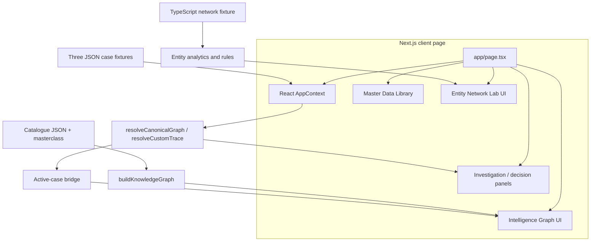
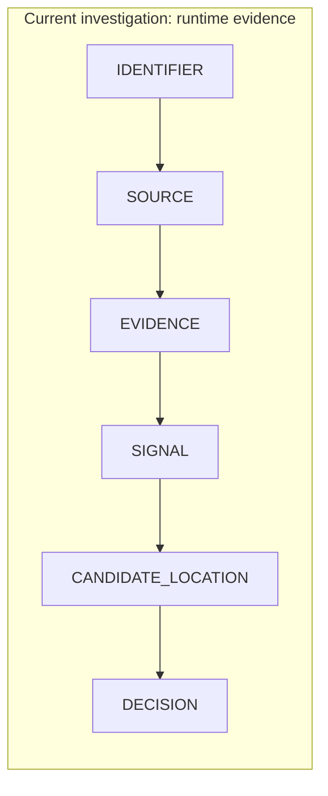

# LOC-IQ — project blueprint

**Scope:** a source-grounded guide to the checked-in Next.js prototype. Start with the [showcase README](README.md) for a short overview. The older [forensic sourcepack](LOC_IQ_WALKTHROUGH_SOURCEPACK.md) records an earlier audit; this blueprint describes the current repository and explicitly separates calculation from simulation.

## 1. Purpose, audience, and maturity

LOC-IQ is a retail-credit and fraud-review *concept workstation*. It asks whether a declared postal PIN is consistent with several location-related observations, and shows how each observation affected the result. Its audience is a reviewer, analyst, or product/engineering stakeholder exploring explainable evidence design. It is a functioning interactive prototype over synthetic fixtures and locally generated scenarios. It is **not** a validated location service, credit risk model, fraud detector, or production decision tool. [Page composition](app/page.tsx) · [Resolver](src/lib/resolver.ts)

The interface uses “probability” or “confidence” terminology in some source data and UI copy. The computation is a normalized share of hand-assigned evidence weights; no statistical calibration, measured accuracy, or real-world risk probability is established. [Resolver](src/lib/resolver.ts) · [Fixture metadata](src/data/data_demo_cases.json)

## 2. A guided tour

1. Open `/`. The client page loads the `fraud` fixture on first render. The left rail and header let you switch to `clean` or `maximum`. [Page](app/page.tsx) · [Context](src/context/AppContext.tsx)
2. In **Investigation**, inspect the six-layer provenance canvas and select a node. The right panel shows ranked candidates, evidence and the `CONSISTENT`, `REVIEW`, or `CONFLICT` address verdict. The graph is a projection of the resolver output. [Graph](src/components/GraphVisualizer.tsx) · [Decision panel](src/components/DecisionPanel.tsx)
3. Choose **New Investigation** to enter identifier-shaped seed strings, a declared PIN, and a simulation profile. The browser creates a deterministic set of synthetic observations from the PIN and profile; it does not query the PAN, Aadhaar, phone, or email. A blank PIN is replaced with `560001` by the custom generator. [Form](src/components/NewInvestigationModal.tsx) · [Generator](src/lib/resolver.ts)
4. Open **Master Data** to browse searchable catalogue records and methodology notes. “Public” and “permissioned” are reference labels, not access enforcement. [Library](src/components/ReferenceLibraryModal.tsx)
5. Open **Intelligence Graph** to inspect catalogue lineage by lens and depth, or find a path. Open **Network Lab** to inspect synthetic cross-case pattern findings, browse instances, or find an entity path. [Knowledge workspace](src/components/IntelligenceGraphWorkspace.tsx) · [Network workspace](src/components/NetworkLabWorkspace.tsx)

The Network Lab's “open case” action uses a simple ID-based mapping to one of the three demo scenarios; it does not reconstruct a unique investigation from each network node. [Page mapping](app/page.tsx)

## 3. System map



| Location | Responsibility |
| --- | --- |
| [`app/page.tsx`](app/page.tsx), [`app/layout.tsx`](app/layout.tsx) | Single `/` page, workspace switching, provider wrapper; no application API routes are checked in. |
| [`src/context/AppContext.tsx`](src/context/AppContext.tsx) | In-memory current input, trace, status, and timestamped UI logs; loads fixtures or calls the custom generator. |
| [`src/lib/resolver.ts`](src/lib/resolver.ts), [`src/types/index.ts`](src/types/index.ts) | Investigation graph, geographic categorization, weighting, candidate ranking, verdict, and domain contracts. |
| [`src/lib/knowledgeGraph.ts`](src/lib/knowledgeGraph.ts), [`src/lib/knowledgeGraphCurated.ts`](src/lib/knowledgeGraphCurated.ts), [`src/lib/activeCaseBridge.ts`](src/lib/activeCaseBridge.ts) | Catalogue schema graph, explicit curated edges, path/lineage utilities, and approximate current-case highlights. |
| [`src/lib/entityNetworkData.ts`](src/lib/entityNetworkData.ts), [`src/lib/entityNetworkAnalytics.ts`](src/lib/entityNetworkAnalytics.ts) | Fixed synthetic entity instances, graph traversal, overlap, and structural rules. |
| [`src/components/`](src/components/) | React Flow canvases, investigation panels, modal library and form, and UI controls. |
| [`src/data/`](src/data/) | Static catalogues, methodology text, and case fixtures; several older JSON files also remain for history. |
| [`scripts/test_engine.ts`](scripts/test_engine.ts) | Deterministic assertions for solver and graph invariants; not a live-service integration test. |

**State and storage.** `AppContext` and component hooks hold the active case in memory. Reloading the page recreates the default fixture. No `localStorage`, `sessionStorage`, server persistence, or database use appears in the application source. The `xlsx` package and data-generation scripts exist in the repository, but they are not part of the live investigation flow. [Context](src/context/AppContext.tsx) · [Manifest](package.json) · [Scripts](scripts/)

## 4. Three different graphs



| Graph | What its nodes mean | How it is populated | Primary use |
| --- | --- | --- | --- |
| Investigation | One case's identifiers, source labels, observed fields, weighted signals, physical hypotheses, decision | [`resolveCanonicalGraph`](src/lib/resolver.ts) from a fixture or generated trace | Explain a single simulated verdict. |
| Knowledge | Identifier *types*, prospective sources, field definitions, derived-signal definitions, topics | [`buildKnowledgeGraph`](src/lib/knowledgeGraph.ts) from catalogue JSON plus [curated mappings](src/lib/knowledgeGraphCurated.ts) | Explore schema lineage, methodology, and access labels. |
| Entity network | Synthetic people, cases, devices, contact values, addresses, endpoints, events, locations | [`buildSyntheticEntityNetwork`](src/lib/entityNetworkData.ts) fixed fixture | Explore relationships across cases and rule findings. |

These are distinct domains. A knowledge node describes a data concept; an entity-network node is a fictional instance; the investigation graph is rebuilt for the selected case. `kgConceptId` can point from a network instance to a schema concept. The [active-case bridge](src/lib/activeCaseBridge.ts) matches current input/field/signal names to catalogue IDs and explicitly maps a few source categories. It is a UI highlighting aid, not a guaranteed complete lineage join; unmatched signal names can remain outside the catalogue graph.

The knowledge graph builds 6 identifier, 46 source, 42 field, 77 signal, and 102 topic nodes from bundled data (273 total). Field-to-signal edges come from `derived_columns` (`DIRECT`); matching `lookup_api` IDs yields `NORMALIZED` source-to-field edges; an explicit registry supplies `CURATED` links. These are *mapping-provenance labels*, not evidence quality scores. A breadth-first traversal supports shortest paths; the UI mounts a filtered subgraph by depth or lens rather than all nodes by default. [Builder](src/lib/knowledgeGraph.ts) · [Workspace](src/components/IntelligenceGraphWorkspace.tsx)

## 5. From observation to address verdict

### 5.1 Input and provenance

The three demos are `clean`, `fraud`, and `maximum` in [`data_demo_cases.json`](src/data/data_demo_cases.json). Each contains seed identifiers, `fetched_fields`, and prewritten `signals` with explicit factors. Source names such as a credit bureau or IP service are labels in these fixtures. The app makes no request to those providers. `resolveCustomTrace` constructs five synthetic observations and four synthetic signals from a form's PIN and profile, then passes them to the same canonical resolver. Its `freshness_date` is display metadata; the resolver does **not** derive `recency_factor` from it. [Context](src/context/AppContext.tsx) · [Generator](src/lib/resolver.ts)

The resolver adds the six types of investigation nodes. Identifier-to-source edges are display provenance drawn from the first two present identifiers, not a verified provider request log. Evidence-to-signal edges attach to the first evidence node with a matching source (or matching label), a visualization shortcut rather than a field-level provenance proof. [Graph construction](src/lib/resolver.ts)

### 5.2 Weight and geographic category

For signal `s`, the code computes:

```text
w(s) = base_weight(s) × recency_factor(s) × ip_trust_factor(s)
W(location) = Σ w(s) for physical signals at that location
            + Σ w(r) for regional signals matched to that location
raw_share(location) = 100 × W(location) / Σ W(all physical candidates)
```

The factors are supplied by fixtures or hard-coded in the custom generator; there is no learned weight fitting. Geographic categories are assigned by ID/label/trust heuristics: `PHYSICAL_LOCALITY` becomes a candidate, `REGIONAL_SCOPE` may corroborate matching localities, and `NETWORK_LOCATION` is recorded separately. Regional matching uses named places and PIN prefixes. A matching regional signal is added to **each** matching physical candidate, so it is corroboration, not an independent physical location. A proxy field raises a separate risk indicator, and a signal with trust factor below 1 is classified as network location and excluded from physical ranking. These string rules are limited and could misclassify unfamiliar places or labels. [Categorization and aggregation](src/lib/resolver.ts)

The UI displays whole-number `evidenceShare` values. The resolver floors every raw share and awards remaining percentage points to the largest fractional remainders (ties use original candidate order). With positive physical weight, the displayed shares sum to exactly 100. With no physical candidate, it returns no ranked candidates. These shares describe the **chosen synthetic evidence weights**, not the probability that a person lives at a location. [Allocation](src/lib/resolver.ts)

### 5.3 Worked example: the `fraud` fixture

The fixture declares Delhi `110001`. Its physical signals contribute `0.9 + 0.4×0.7 = 1.18` to Anantapur `515001`, `0.7×0.8 = 0.56` to `515272`, and `0.5×0.8 = 0.40` to `500001`; total physical weight is `2.14`. Raw shares are approximately `55.14%`, `26.17%`, and `18.69%`. Largest-remainder allocation displays **55%, 26%, 19%**. The Frankfurt proxy signal has `0.95×1×0.1 = 0.095` effective weight, but is a network observation, so it contributes **zero** to this physical-share denominator. The top candidate differs from the declared PIN's district prefix and holds at least 40% share, yielding `CONFLICT`. [Fixture](src/data/data_demo_cases.json) · [Resolver](src/lib/resolver.ts)

The `clean` fixture instead leads with declared Bengaluru `560001` and resolves `CONSISTENT`. The `maximum` fixture declares Mumbai `400001` while its multi-source physical evidence leads to Pune `411001`, resolving `CONFLICT`. These are designed demonstrations, not measured fraud outcomes. [Fixtures](src/data/data_demo_cases.json) · [Engine assertions](scripts/test_engine.ts)

### 5.4 Exact verdict rules

After ranking by total supporting weight, the resolver chooses the first candidate and compares it with the declared PIN. It returns:

| Result | Current rule |
| --- | --- |
| `REVIEW` | Declared PIN is blank, no physical candidate exists, or the mismatch is ambiguous by the rules below. |
| `CONSISTENT` | Six-digit exact PIN match; or the leading candidate's label contains the declared numeric PIN (at least four digits); or the declared candidate ranks first with at least 50% displayed share. |
| `CONFLICT` | No first-three-digit district match **and** the top candidate has at least 40% displayed share, after consistency checks fail. |

Other cases return `REVIEW`, including split evidence or a matching three-digit district prefix. “Valid” declaration in code means a nonempty string; the custom form has no strict PIN or identifier verification. Candidate `contradictions` are explanatory comparisons with the top hypothesis, not independently weighted negative evidence; `totalContradictingWeight` is initialized to zero. A proxy risk indicator does not independently force `CONFLICT`. [Decision logic](src/lib/resolver.ts)

## 6. Cross-case network analysis

The [fixed fixture](src/lib/entityNetworkData.ts) defines 79 synthetic instance nodes and 61 relationships across people, applications, devices, identifiers, IP endpoints, addresses, merchants, and events. The [analytics module](src/lib/entityNetworkAnalytics.ts) provides neighborhood, degree, connected-component, shared-neighbor, overlap, and breadth-first shortest-path operations. The UI starts in a finding view and also offers Explore and Path modes. [Network workspace](src/components/NetworkLabWorkspace.tsx)

The structural findings are deterministic threshold rules over typed entities:

| Rule | Count and threshold | Classification in fixture |
| --- | --- | --- |
| Shared device | At least 3 distinct `PERSON` neighbors of a device | `STRONG_ENTITY_LINK` |
| Reused contact value | At least 2 distinct `PERSON` nodes linked by `HAS_IDENTIFIER` | `STRONG_ENTITY_LINK` |
| Shared proxy endpoint | At least 3 distinct `APPLICATION` neighbors of a proxy endpoint | `CONTEXTUAL_LINK` |
| Address concentration | At least 4 distinct `APPLICATION` nodes with `DECLARED_AT` at an address | `CONTEXTUAL_LINK` |
| Geographic convergence | At least 2 distinct `APPLICATION` nodes traced via event/merchant nodes to a location | `CONTEXTUAL_LINK` |
| Benign household example | Two named fixture cases share address and IP; separate devices/PANs are described in the example | `CONTEXTUAL_LINK` |

Findings carry their focal entity, observed and threshold entity types, supporting edge IDs, paths, and—where applicable—excluded nonqualifying neighbors. For example, a device's graph degree may include an app-instance node; the shared-device rule counts only distinct `PERSON` neighbors. The household rule is a fixture-specific counterexample, not a general classifier that verifies benign households. Shared infrastructure and graph paths establish relationships in the fixture, **not** identity equivalence or actual fraud. [Rules](src/lib/entityNetworkAnalytics.ts) · [Assertions](scripts/test_engine.ts)

## 7. Data provenance and trust boundaries

| Asset | What it supplies | What it does not establish |
| --- | --- | --- |
| [`data_primary_identifiers.json`](src/data/data_primary_identifiers.json) | Six identifier-type descriptions | A real identity lookup or consent record. |
| [`data_api_universe.json`](src/data/data_api_universe.json) | 46 prospective provider/source entries and access notes | Working connectors, contracts, permissions, or current API availability. |
| [`data_fetched_data_fields.json`](src/data/data_fetched_data_fields.json) | 42 field definitions and derived-column prose used to construct 77 catalogue signal nodes | Runtime retrieval or validated formulas for all 77 signals. |
| [`masterclass.json`](src/data/masterclass.json) | 102 explanatory topics | External verification of every research statement. |
| [`data_demo_cases.json`](src/data/data_demo_cases.json) | Three synthetic observations and preweighted signals | Real bureau, bank, telecom, network, or customer records. |
| [`entityNetworkData.ts`](src/lib/entityNetworkData.ts) | Synthetic cross-case instances and relationships | A production entity-resolution data set. |

The repository has no application server endpoint, account system, provider secrets, permissions enforcement, or data-retention controls. Access and consent terms in the catalogue are informational. The form accepts PAN, Aadhaar, phone and email-shaped strings, and the current trace remains in browser memory while the page is open. For exploration, enter fictional values only. Any real deployment or regulated-data use would require permissioned data acquisition, consent/legal review, access controls, secure storage and retention design, auditing, validation, and human decision governance. [Form](src/components/NewInvestigationModal.tsx) · [Context](src/context/AppContext.tsx) · [Library](src/components/ReferenceLibraryModal.tsx)

## 8. Setup and troubleshooting

Requirements: a Node.js/npm environment compatible with the checked-in [Next.js manifest](package.json). No external API keys or database are required for the synthetic app.

```bash
git clone https://github.com/tharungajula2/loc-iq.git
cd loc-iq
npm ci
npm run dev       # open http://localhost:3000
npm test          # deterministic engine assertions (npx tsx)
npm run lint      # ESLint
npm run build     # optional production build
```

`npm test` uses `npx tsx scripts/test_engine.ts`; if `tsx` is absent, npm may need to obtain it. The package does not list `tsx` directly. This documentation audit did not install packages or run those commands. [Manifest](package.json) · [Test script](scripts/test_engine.ts)

| Symptom | Check |
| --- | --- |
| Default case reappears after reload | Expected: state is in React memory and `/` loads `fraud` on first mount. |
| Entered identifier does not retrieve records | Expected: custom traces are synthesized from the PIN/profile; there are no provider calls. |
| Proxy endpoint absent from candidate list | Expected: network locations are separated from physical hypotheses; check risk indicators and network observations. |
| Some catalogue nodes lack a path | Expected: the builder only adds direct, normalized, and curated mappings; it does not infer missing edges. |
| Test command asks to install `tsx` | The script invokes `npx tsx`; decide whether to install that developer tool locally before running. |

## 9. Tests, limitations, and extension path

[`scripts/test_engine.ts`](scripts/test_engine.ts) contains assertion checks for demo outcomes, deterministic custom scenarios, 100% share allocation, proxy exclusion, missing declaration, knowledge-graph integrity, path search, synthetic-network patterns, and typed counts. The checked-in script is evidence of intended invariants; this documentation pass did **not** execute it, a browser flow, lint, or a production build. No measured accuracy, latency, or operational performance claim follows from these tests.

Important limits to carry into any reuse:

- Factors, thresholds and regional lookup rules are hand-selected. There is no calibration, independent ground truth, uncertainty estimate, or fairness analysis. [Resolver](src/lib/resolver.ts)
- Fixture `freshness_date` does not cause recency decay; the `recency_factor` comes from preweighted signals. Some provenance edges are presentational shortcuts rather than verified field-level lineage. [Resolver](src/lib/resolver.ts)
- The source catalogue includes prospective/permissioned APIs, but none are connected. Derived-signal catalogue entries are definitions, not 77 running analytical calculations. [Knowledge graph](src/lib/knowledgeGraph.ts) · [Context](src/context/AppContext.tsx)
- The network and its thresholds are fixed examples. Finding classification indicates structural context, not a validated fraud label. [Network data](src/lib/entityNetworkData.ts) · [Rules](src/lib/entityNetworkAnalytics.ts)
- Case state is ephemeral; there is no user account, persistence, case review history, or decision audit trail. The UI is desktop-oriented. [Context](src/context/AppContext.tsx) · [Page](app/page.tsx)

A credible next version would first define real permitted data contracts and case schemas; replace name-based lineage shortcuts with explicit source-to-field mappings; validate geographic lookups and time-based decay; evaluate weights and review thresholds against consented, labeled cases; and add secure persistence plus human-review records. Keep the current separation between physical, regional, and network observations and the typed explanations for every network finding. These are design directions, not implemented features.
