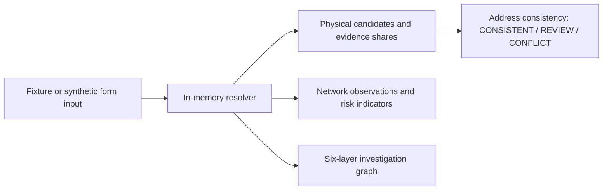

# LOC-IQ

**An explainable location-evidence workstation for retail credit and fraud-review scenarios.**

LOC-IQ explores a practical question: when an applicant declares a postal PIN, what do several imperfect location signals actually support? The interactive Next.js prototype turns **synthetic** bureau, branch, IP, telecom, and operational observations into a traceable investigation graph, ranks physical-location hypotheses, and explains an address-consistency verdict. It is a portfolio demonstration, **not** a live underwriting or fraud-decision system.

**Explore:** [Technical and product blueprint](PROJECT_BLUEPRINT.md) · [Historical forensic sourcepack](LOC_IQ_WALKTHROUGH_SOURCEPACK.md) · [Engine assertions](scripts/test_engine.ts)

## What you can inspect

| Surface | Implemented behavior |
| --- | --- |
| Investigation | Switch among three fixture cases or synthesize a new scenario; inspect identifier → provider → observation → signal → candidate → decision provenance, evidence contributions, and the verdict. |
| Master Data Library | Search and filter a reference catalogue of 6 primary identifier types, 46 prospective data sources, 42 fields, 77 derived-signal definitions, and 102 methodology topics. These are catalogue entries, not connected services. |
| Intelligence Graph | Explore the catalogue's typed lineage links, provenance labels (`DIRECT`, `NORMALIZED`, `CURATED`), limited-depth views, active-case lens, and shortest paths. |
| Entity Network Lab | Explore a fixed synthetic multi-case graph, inspect rule findings and supporting edges, and find paths between case entities. |

The three fixture cases illustrate coherent evidence (`clean`), a physical-location conflict with a proxy observation (`fraud`), and a larger multi-source conflict (`maximum`). The custom form offers `baseline`, `proxy_risk`, and `physical_conflict` simulation profiles. The resolver calculates the displayed candidate shares at runtime from fixture or generated signals; it does not look up the entered identifiers. [Case fixtures](src/data/data_demo_cases.json) · [Custom generator and resolver](src/lib/resolver.ts) · [App state](src/context/AppContext.tsx)



## Evidence, carefully labeled

- **Implemented analysis:** `effective weight = base weight × recency factor × IP trust factor`; physical signals are aggregated by location, regional signals can corroborate matching localities, and a largest-remainder allocation makes displayed integer shares total 100% when physical weight exists. The verdict compares the leading physical candidate with the declared PIN. [Resolver](src/lib/resolver.ts)
- **Illustrative inputs:** All three cases and the multi-case entity network are bundled fixtures. Custom investigations synthesize observations locally from the form's postal PIN and selected profile. Provider names in fixtures indicate *hypothetical provenance*, not completed API requests. [Fixture cases](src/data/data_demo_cases.json) · [Entity fixtures](src/lib/entityNetworkData.ts)
- **Interpretation limit:** Evidence shares are relative fractions of chosen weights, **not calibrated probabilities**. The weights, thresholds, regional mapping, and network pattern rules are demonstration choices. A proxy flag is a separate observation; it does not by itself turn matching physical evidence into an address conflict. [Resolver](src/lib/resolver.ts) · [Network rules](src/lib/entityNetworkAnalytics.ts)

## Architecture at a glance

Next.js 16 App Router and React 19 host a client-side TypeScript workstation. React Context holds the current case and logs; React Flow renders the graphs. JSON catalogues and TypeScript fixtures supply the data. There is no application API route, database, authentication, persistent case store, ML model, or live provider integration in this repository. The interface and resolver are implemented, while their data and decisions remain a simulation. [App page](app/page.tsx) · [Context](src/context/AppContext.tsx) · [Package manifest](package.json)

## Run locally

```bash
git clone https://github.com/tharungajula2/loc-iq.git
cd loc-iq
npm ci
npm run dev
```

Open `http://localhost:3000`. `npm test` runs the repository's deterministic engine assertion script; `npm run lint` invokes ESLint. This documentation review inspected source and fixtures; it did not install dependencies, run a build, or verify a hosted deployment. See the [setup, worked examples, limitations, and source map](PROJECT_BLUEPRINT.md).

> **Use synthetic inputs only.** The UI accepts identifier-shaped strings, but this prototype has no consent workflow, authorization boundary, or operational privacy controls.
